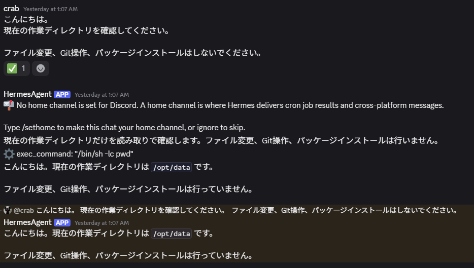
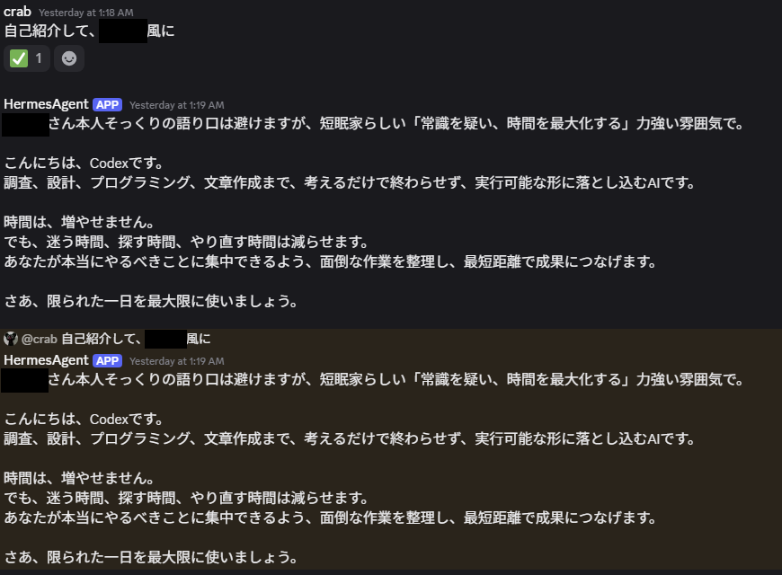
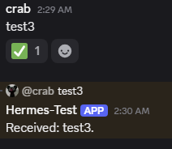

# はじめに

はい、どうもcrabです。
本日はHermes Agentを導入してDiscordと連携した記録について話したいと思います。
Hermes Agentとはオープンソースの自律型AIエージェントです。このエージェントとchatgptを連携させることでエージェント経由でchatgptやcodexを動かして、コード作成など様々なことが出来るみたいです。  
また、このエージェントは学習を通してトークンの節約もしてくれるみたいです！さらに、Discordなどマルチプラットフォームと接続可能でchatgptのデスクトップアプリのように使えます！  
イメージとしてはこんな感じです。

```text
Discord
   ↓
Hermes Agent
   ↓
AIモデル / Codex / 各種ツール
   ↓
コード作成・ファイル操作など
```

PCのターミナルを直接操作しなくてもDiscordから指示を出せるのは、なかなか面白そうです。  
また、Hermes AgentにはMemoryやSkillsなど、過去の情報や手順を再利用するための仕組みも用意されています。  
うまく活用すれば、毎回同じ説明をAIにする必要を減らせそうです。

とここまでHermes Agentについて話しましたが、こちらは友人が教えてくれました。ありがとうございます😃

## 今回作る環境

今回構築する環境は以下のような構成です。

```text
PC / スマートフォン
        │
        ▼
     Discord
        │
        ▼
   Discord Bot
        │
        ▼
  Hermes Gateway
        │
        ▼
   Hermes Agent
        │
        ├── Codex
        ├── 各種Tools
        └── Memory / Skills
        │
        ▼
      Docker
        │
        ▼
  作業ディレクトリ
  ```

今回はHermes AgentをWindows上へ直接インストールするのではなく、Dockerコンテナ内で動作させることにしました。
なぜDocker上に構築したかですが、理由の一つがセキュリティです。  
Hermes AgentのようなAIエージェントは、設定次第でコマンドを実行したり、ファイルを読み書きしたりできます。
これは非常に便利なのですが、AIが意図しないコマンドを実行してしまった場合、普段使用しているPC環境へ直接影響する可能性があります。  
そこで今回は、

```text
Windows
│
├── 普段使用する環境
│
└── Docker
     └── Hermes Agent
  ```

というように、Hermes AgentをDockerコンテナの中に隔離して動かすことにしました。  
もちろん、Dockerを使えば何をしても安全というわけではありません。  
例えばホスト側のディレクトリをDockerへマウントすれば、そのディレクトリについてはHermesからアクセスできる可能性があります。  
そのため今回は、Hermesからアクセスさせるディレクトリも必要な範囲に限定します。  
僕の場合は、開発中のアプリを

```text
/workspace/"開発中のアプリフォルダ"
  ```

としてDocker側からアクセスできるようにしています。  
これによって、Hermesには基本的にこのプロジェクトを中心に作業してもらう構成にしました。

## Hermes Agentの導入

それではHermes Agentを導入していきます。  
今回はDockerを利用します。

まずWindows側にHermes用のディレクトリを作成しました。

```powershell
mkdir C:\Users\<ユーザー名>\hermes-docker
cd C:\Users\<ユーザー名>\hermes-docker
```

このディレクトリ内に、

```text
hermes-docker/
├── Dockerfile
├── compose.yaml
├── .env
└── ...
  ```

といったDocker関連のファイルを配置していきます。

Dockerfileとcompose.yaml、.envは以下のように作りました。  
Dockerfileで記述しているHermes Agentのバージョンが最新ではないですが、この理由については後程記載します。  
envファイルはDiscord関連の設定です。こちらについても後で説明するDiscordの連携に関連します。

```dockerfile title="Dockerfile"
FROM nousresearch/hermes-agent:v2026.7.7.2

USER root

RUN npm install -g @openai/codex \
    && npm cache clean --force

USER hermes
```

```yaml title="compose.yaml"
services:
  hermes:
    build:
      context: .
      dockerfile: Dockerfile

    container_name: hermes
    restart: unless-stopped

    env_file:
      - .env

    volumes:
      - ./hermes-data:/opt/data
      - ../projects/"プロジェクト名":/workspace/"プロジェクト名"

    working_dir: /workspace/"プロジェクト名"

    environment:
      CODEX_HOME: /opt/data/codex

    command: ["gateway", "run"]
```

```env title=".env"
DISCORD_REQUIRE_MENTION=true
DISCORD_ALLOW_ALL_USERS=false
DISCORD_ALLOW_ANY_ATTACHMENT=false
DISCORD_MAX_ATTACHMENT_BYTES=33554432
DISCORD_REPLY_TO_MODE=on
```

次にDockerイメージをビルドして起動します。

```powershell
docker compose build
docker compose up -d
```

起動できているか確認します。

```powershell
docker compose ps
```

正常に起動していれば、Hermesのコンテナが Up になっているはずです。

Hermes Agentのバージョンも確認してDockerfileで設定したバージョンと合っているか確認します。

```powershell
docker compose exec hermes hermes --version
```

これでHermes Agent自体の準備は完了です。

## Discord Botの作成

次にDiscord側の準備をします。

Hermes AgentとDiscordを直接接続するのではなく、Discord Botを作成し、そのBotをHermesから利用します。

[Discord Developer Portal](https://discord.com/developers/home)を開き、新しいApplicationを作成します。

Applicationを作成したら、Botの設定画面へ移動します。

BotがDiscordに投稿されたメッセージの内容を取得できるように、"Message Content Intent"を有効にします。ほかの設定については適当にAIに聞いてやってみてください笑

次にBot Tokenも取得します。このTokenは後ほどHermes Agent側の設定で使用します。
このTokenはパスワードのようなものなのでAIとかに送らないようにしてローカルで保管するようにしてください！

また、今回のBotはDiscordサーバーで利用するため、Guild Installを使用しました。

InstallationのページでScopesには、以下を設定します。

```text
bot
applications.commands
```

そしてPoermissionsでBotには必要な範囲の権限のみを付与します。

```text
View Channels
Send Messages
Embed Links
Attach Files
Read Message History
Send Messages in Threads
Add Reactions
```

などです。

今回は Administrator 権限は付与しませんでした。AIエージェントと接続するBotなので、必要以上に強い権限を与えないようにします。

設定が完了したら、作成したBotを自分のDiscordサーバーへ招待します。

## Hermes Agent側でDiscordを設定・起動

Discord Botを作成したので、次はHermes Agentと接続します。

HermesにはGatewayのセットアップ機能があります。Powershellで以下コマンドを打ちます。

```powershell
docker compose exec -it hermes hermes gateway setup
```

セットアップ画面からDiscordを選択します。すると以下の3つについて順番に設定する画面が出ます。

1. Bot Tokenの設定
2. Allowed Usersの設定
3. Home Channelの設定

1.では先ほど取得したBot Tokenを設定します。  
2.では自分のDiscordアカウントのUser IDを入力します。Hermes AgentはDiscordから指示を受けてさまざまな処理を実行できるため、誰でもBotを操作できる状態にはしたくありません。なので、これで指示を送れるユーザを制限します。DiscordのDeveloper Modeを有効にすると、自分のUser IDを取得できます。  
3.ではHermesからの通知などを送信するためのDiscordチャンネルのchannel IDを入力します。ここはセットアップ時に指定することもできますが、後から設定することもできます。

以上で設定が完了したのでHermesを再起動します。

```powershell
docker compose restart hermes
```

ログも確認してみます。

```powershell
docker compose logs -f hermes
```

Discord上でBotがオンラインになれば、ひとまず接続成功です。

## DiscordからHermesを操作してみる

それでは実際にDiscordからHermesへ話しかけてみます。

例えば、

現在の作業ディレクトリを確認してください。

と送信します。

Hermesから以下のような応答が来るはずです。



他にも自己紹介もしてもらいました。プライバシー保護のため、一部黒塗りにしています。



ただ、この画像をみるとHermes Agentから２回同じ返信が来ています。。本来なら１回しか来ないはずなのでバグってますね。  
この対処法についてはこの次で説明します！

これで、

```text
Discord
   ↓
Hermes Gateway
   ↓
Hermes Agent
   ↓
Codex / Tools
   ↓
/workspace/"プロジェクトフォルダ"
```

という環境を作ることができました！

PCの前でHermesのCLIを開かなくても、Discordから指示できるのは便利ですね！  
スマートフォンのDiscordからも操作できるので、今後いろいろ試してみたいと思います。

## ハマったポイント Botの2重返信

この問題にはかなり振り回されました。

DiscordからHermesへメッセージを送信すると、なぜか同じ内容の返信が2回来ます。

Discordの動作確認のところで載せた画像のように通常のメッセージと元のメッセージに対するReply
の2種類で同じ回答が返ってきました。

2重で返答が返ってくる原因として以下の可能性を考えて対処を行いました。

- Botの二重起動の対策
- Discordから2回受信の停止
- Streamingの無効化
- Discord Botの作り直し
- HermesのDiscordコードの確認
- Hermes Agentのバージョンダウン

以上の対策を行いましたが、正解は最後のHermes Agentのバージョンダウンでした。  
もともとDockerfileでバージョンはlatestにして最新のバージョンを取得していたのですが、最初は直近の安定化バージョンであるv2026.7.30にしたのですが、これでも治りませんでした。  
これのせいで解決法がわからず、かなり時間がかかってしまいました。。最終的にchatgptは見捨ててclaudecodeに浮気して解決しました笑

最終的に正常に動作したのが、

```text
FROM nousresearch/hermes-agent:v2026.7.7.2
```

です。

そしてDiscordからもう一度メッセージを送ってみると返信が1回だけになりました！


かなり長いこと原因を探しましたが、少なくとも僕の環境では、Hermes Agentのバージョンを v2026.7.7.2 に戻すことで問題が解消しました。

新しいDiscord Botを作成しても再現していたことや、コンテナ・Gatewayの二重起動も確認できなかったことから、Hermes Agentの新しいバージョン側におけるDiscord関連処理のバージョン依存問題だった可能性が高そうです。

ただし、今回は問題のコードそのものまで特定したわけではないので、

「このバージョン以降には必ずこのバグがある」

と断定することはできません。

あくまで僕の環境では、

```text
新しいHermes Agent
    ↓
Discordで二重返信が発生
```

```text
v2026.7.7.2
    ↓
正常に1回だけ返信
```

という結果になりました。

同じ問題に遭遇した方は、Hermes Agentのバージョンを確認してみるとよいかもしれません。

最初はとある短眠家の方の呪いかと思ってしまいました。。

## まとめ

今回はHermes AgentをDocker上に構築し、Discord Botと連携してみました。

今後はこの環境を使って、Codexと連携しながらアプリ開発などにも活用していきたいと思います。
